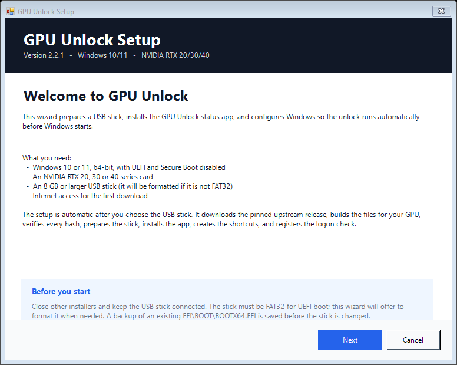

# GPU Unlock for Windows

A guided Windows setup for the NVIDIA tensor-rate unlock. The wizard prepares a
USB stick, installs a status app, and configures Windows automatically for the
GPU it detects. The unlock itself runs from the USB stick **before** Windows
starts; the status app confirms it after Windows is up.

> **Status app result:** green `UNLOCKED` means `SS0 = 0x88888888` and the low
> nibble of `SS1` is `0x8`. Red `NOT UNLOCKED` means replay the USB boot and
> check the BIOS boot order.



Printable version: **[GPU Unlock setup and user guide (PDF)](docs/GPU-Unlock-Guide.pdf)**.
The setup wizard and the status app's **Open guide** button open this PDF.

## Quick start (non-technical)

1. Download or clone this repository to a folder on the PC.
2. Double-click **`SETUP.cmd`**.
3. Approve the Windows administrator prompt.
4. The wizard checks Windows, .NET, firmware and your NVIDIA card.
5. Select the USB stick (it is preselected when only one removable drive is
   present). Click **Next**.
6. If the stick is not FAT32, confirm the format. **Formatting erases the
   stick.**
7. Leave the defaults on the next page and click **Install**.
8. Wait for the download, asset build and USB copy to finish.
9. Restart, enter BIOS/UEFI (usually **Del** or **F2**), set the **`UEFI: ...`**
   USB entry as **Boot Option #1**, then save and exit (**F10**).

From then on:

- **Stick connected + restart** → unlock runs before Windows.
- **Stick removed** → Windows boots normally, no unlock.
- **GPU Unlock** in the Start Menu / Desktop shows the current status.
- A logon check warns only when the unlock is not active.

The only required interaction after the wizard starts is choosing the USB stick
and confirming a format when the stick is not already FAT32. Everything else is
applied from the detected hardware and Windows version.

## What the wizard does

| Step | What happens |
| --- | --- |
| System check | Windows 10/11 64-bit, administrator, PowerShell 5.1+, .NET 4.7.2+, UEFI, Secure Boot, Fast Startup, BitLocker and NVIDIA GPU |
| Download | Pinned upstream release `v2.1.10`; every file is SHA-256 verified |
| Build | Generates the files for the detected RTX 20/30/40 family (or all families for a mixed machine) |
| USB | Selects a removable drive, backs up an existing `EFI/BOOT/BOOTX64.EFI`, formats to FAT32 when needed, copies and verifies every hash |
| Markers | Writes the 5-second unattended marker and quiet-console marker |
| Windows app | Installs to `%ProgramFiles%\GPU Unlock`, creates Desktop/Start Menu shortcuts, an uninstall shortcut, and the `GpuUnlockStatus` logon task |
| Registry | Records the install path, version, auto-start and cache settings under `HKCU\SOFTWARE\GpuUnlock`; registers the Apps & Features uninstall entry |
| Dependencies | No extra runtimes are downloaded on Windows 10/11; the wizard verifies the built-in components and stops with a clear message if one is missing |

## Requirements

- **Windows 10 or 11, 64-bit.**
- **UEFI** firmware. Legacy/BIOS boot is not supported.
- **Secure Boot disabled** (the upstream loader is not signed for Secure Boot).
- An **NVIDIA RTX 20, 30 or 40 series** card. GTX 16 is experimental upstream;
  RTX 50 (Blackwell) is not supported.
- An **8 GB or larger USB stick**. It must end up FAT32; the wizard offers to
  format it.
- Internet access for the first download (release and upstream assets).
- Administrator rights (the wizard requests them).
- If **BitLocker** is enabled, keep the recovery key before changing boot
  settings. The wizard warns but does not disable BitLocker.

## Supported hardware

| Family | Cards | Status |
| --- | --- | --- |
| `ad102` | RTX 40 series (Ada) | Fully built and supported |
| `ga102` | RTX 30 series (Ampere) | Built and supported |
| `tu10x` | RTX 20 series / GTX 16 (Turing) | RTX 20 supported; GTX 16 experimental upstream |
| — | RTX 50 (Blackwell) | Not supported |

Mixed-generation machines get all supported families on one stick. The loader
picks the right family at boot.

## The one-time BIOS step

Windows cannot reliably change the firmware boot order. Do this once:

1. Keep the USB stick connected.
2. Restart and press **Del** (or **F2**) at the vendor logo.
3. Open the **Boot** tab.
4. Set the stick's **`UEFI: ...`** entry as **Boot Option #1**.
5. Set **CSM Support = Disabled** and **Secure Boot = Disabled** if present.
6. Press **F10**, save and exit.

Detailed guide: [docs/BIOS-SETUP.md](docs/BIOS-SETUP.md).

After that, leaving the stick in is enough to replay the unlock on every boot.
Removing the stick is the complete rollback: no ESP, NVRAM boot-order or VBIOS
changes are made by this tool.

## Daily use

- **Stick in + restart** → the loader runs, unlocks the card, and chains into
  Windows.
- **Stick out** → Windows boots normally.
- **Sleep or power loss** can clear the volatile register state. Restart with
  the stick.
- **Unlock is volatile** by design; it is re-applied on every replay.

## Status app and verification

Open **GPU Unlock** from the Desktop or Start Menu. The app shows:

- `UNLOCKED` / `NOT UNLOCKED`
- the GPU name and PCI bus ID
- `SS0` and `SS1`
- the raw `ssdiag` output

The app has **Check again**, **Repair selectors** (`ssdiag --reapply`), **Open
guide** (the printable PDF) and **Open log** buttons. The log is
`%LOCALAPPDATA%\gpu-unlock-windows\status.log` and rotates automatically (five
files, 5 MB each).

Command line check (elevated PowerShell):

```powershell
.\verify.ps1 -Elevate
```

Expected when active: `SS0 = 0x88888888`, `SS1` low nibble `0x8`.

## Uninstall

Double-click **`UNINSTALL.cmd`** (or open **Uninstall GPU Unlock** from the
Start Menu, or use **Apps & Features**).

The uninstaller removes:

- the `GpuUnlockStatus` scheduled task
- Desktop and Start Menu shortcuts, including the uninstall shortcut
- the Apps & Features entry
- `HKCU\SOFTWARE\GpuUnlock`
- the installed `%ProgramFiles%\GPU Unlock` folder
- the download cache and installer logs

It leaves these alone by default:

- the USB stick (the wizard offers to remove generated stick files)
- the local backup of the stick's previous `BOOTX64.EFI`
  (`%LOCALAPPDATA%\gpu-unlock-windows\backup`)

Advanced uninstall options:

```powershell
.\Uninstall.ps1 -Remove -Force                  # complete Windows cleanup
.\Uninstall.ps1 -Remove -Force -CleanStick      # also remove generated stick files
.\Uninstall.ps1 -Remove -Force -RemoveBackups   # also delete the local backup
```

`-CleanStick` removes only GPU Unlock-generated files and markers from a stick
that contains GPU Unlock markers. It leaves `EFI/BOOT/BOOTX64.EFI` in place; to
erase the stick completely, format it.

## Troubleshooting

See [TROUBLESHOOTING.md](TROUBLESHOOTING.md) for symptom → fix entries,
including:

- stick not listed or boots straight to Windows
- black screen / frozen image during the transaction
- Windows Recovery errors after a green log
- `ssdiag` access errors (HVCI / kernel AV)
- antivirus flags on `ssdiag.exe`
- wrong or reverted `SS0`/`SS1`
- unlock gone after sleep or power loss
- scheduled task or shortcut missing

**Recovery if Windows does not start:** power off, remove the stick, boot
normally. No boot-order, ESP or VBIOS change is required to recover.

## Advanced command line

The wizard is the recommended path. The underlying scripts remain available:

```powershell
# Full setup, automatic family detection, specific stick, non-interactive format
.\setup.ps1 -Family localhost -Stick E: -FormatStick -ConfirmFormat

# Prepare a stick only
.\install.ps1 -Family localhost -Stick E: -Interactive:$false

# Install the Windows app only
.\setup.ps1 -InstallApp

# Dry run / WhatIf (no download or copy)
.\setup.ps1 -DryRun
.\setup.ps1 -WhatIf

# Verify
.\verify.ps1 -Elevate
```

Useful `setup.ps1` switches: `-Family ad102|ga102|tu10x|all|localhost`,
`-Stick E:`, `-FormatStick -ConfirmFormat`, `-Interactive:$false`, `-Cache`,
`-InstallApp`, `-InstallStick`, `-NoApp`, `-NoStick`, `-NoDesktop`,
`-NoStartMenu`, `-NoAutoStart`, `-Silent`, `-SkipElevation`.

## Files

| Path | Purpose |
| --- | --- |
| `SETUP.cmd` | Double-click entry point for the setup wizard |
| `UNINSTALL.cmd` | Double-click entry point for the uninstall wizard |
| `app/SetupWizard.ps1` | Next/Next setup UI |
| `app/UninstallWizard.ps1` | Uninstall UI |
| `app/GpuUnlock.ps1` | Status window / logon check |
| `app/Install-App.ps1` | Windows app installer (shortcuts, task, registry, uninstaller) |
| `setup.ps1` | CLI setup orchestrator |
| `install.ps1` | USB stick preparation |
| `Uninstall.ps1` | CLI uninstaller |
| `verify.ps1` | CLI verification with `ssdiag` |
| `Unlock/` | PowerShell module (`Unlock.psd1` + focused submodules) |
| `tests/run-tests.ps1` | Dependency-free regression suite |
| `tests/parse-all.ps1` | Syntax check for every PowerShell file |
| `tests/run-tests.Pester.ps1` | Optional Pester 5+ suite |
| `unlock.config.json` | Pinned release, asset names, app defaults |
| `VERSION` | Single source of truth for the version |
| `docs/BIOS-SETUP.md` | One-time firmware step |
| `docs/GPU-Unlock-Guide.pdf` | Printable setup and user guide (opened by the app) |
| `docs/build-guide.py` | Maintainer script that rebuilds the PDF guide |
| `TROUBLESHOOTING.md` | Symptom → fix |
| `LICENSE` | MIT license for this project |
| `THIRD-PARTY-NOTICES.md` | Upstream GPL-2.0 and NVIDIA terms |

## Safety and recovery

- No ESP, NVRAM `BootOrder`, VBIOS or firmware changes are made by this tool.
- The USB stick is the rollback: remove it and Windows boots normally.
- The wizard backs up an existing `EFI/BOOT/BOOTX64.EFI` before changing a
  stick. The backup is kept on uninstall unless you remove it explicitly.
- Every downloaded release file is SHA-256 verified against the pinned
  manifest before it is used.
- `ssdiag.exe` is an unsigned diagnostic with an embedded kernel driver; some
  antivirus engines flag it. It is downloaded separately from the upstream
  release for that reason.
- Do not retry after a boot fault in the same session; power off fully first.
- Keep `loader.log` from the stick root if you need to report a boot problem.

## Development

```powershell
# Primary suite (Windows PowerShell 5.1 or PowerShell 7)
powershell -NoProfile -ExecutionPolicy Bypass -File .\tests\run-tests.ps1

# Syntax check every .ps1/.psm1
powershell -NoProfile -ExecutionPolicy Bypass -File .\tests\parse-all.ps1

# Optional Pester 5+ suite
Install-Module -Name Pester -Force -Scope CurrentUser
Invoke-Pester -Path .\tests\run-tests.Pester.ps1

# Rebuild the printable PDF guide (maintainers, needs reportlab)
python -m pip install reportlab
python .\docs\build-guide.py
```

GitHub Actions runs the parse check and the primary suite on PowerShell 7 and
Windows PowerShell 5.1 for pushes and pull requests.

The module is organized by responsibility:

- `Config.psm1` — config, constants, bus-ID conversion
- `Environment.psm1` — preflight checks and log rotation
- `Release.psm1` — pinned release download and hash verification
- `Staging.psm1` — staging validation and USB copy/format
- `Markers.psm1` — unattended/quiet markers
- `Diagnostics.psm1` — `ssdiag` parsing
- `Hardware.psm1` — GPU and removable-drive detection

## License

This project's own code is **MIT licensed** — free for personal and commercial
use, modification and redistribution. See [LICENSE](LICENSE).

The setup downloads the upstream
[`physicsdolphin/nv-uefi-unlocker`](https://github.com/physicsdolphin/nv-uefi-unlocker)
components, which are **GPL-2.0-only**, and NVIDIA firmware under NVIDIA's
terms. Those components are not redistributed in this repository; a prepared
USB stick contains them. See [THIRD-PARTY-NOTICES.md](THIRD-PARTY-NOTICES.md)
before redistributing a stick.
